# Fragile Dreams Launcher — *Fragile Dreams: Farewell Ruins of the Moon* (Dionixu's Launcher)

> Una forma de jugar *Fragile Dreams* (Wii) en PC, con el cariño que merece.
> *A way to play Fragile Dreams (Wii) on PC, with the care it deserves.*

[](https://ko-fi.com/dionixu838824)
[](../../releases/latest)


**Español** · [English](#english)

Launcher, motor e instaladores para Windows y Linux que convierten **tu copia original europea** de *Fragile Dreams: Farewell Ruins of the Moon* (Wii) en una experiencia de PC: **traducción al castellano integrada**, cámara con stick derecho y ratón, movimiento en 360°, **60 FPS**, iconos de mando Xbox o de teclado y ratón, menú de pausa y logros.

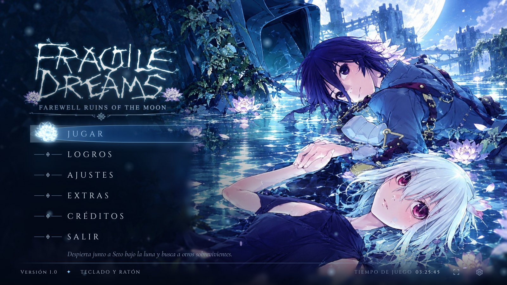

---

## ⚠️ Aviso legal

- Este proyecto **NO incluye el juego**.
- Necesitas **tu propia copia original** de *Fragile Dreams* para Wii, extraída por ti de tu disco (por ejemplo con tu Wii y CleanRip):
  - **Versión europea (PAL), ID `R2GP99`. Es la única que sirve.** La americana (`R2GEXJ`) y la japonesa no funcionan.
- El instalador comprueba tu copia (ID y huella MD5) y **solo funcionará con tu copia oficial sin modificar**.
- **No se acepta ni se fomenta la piratería.** No descargues ni compartas imágenes de juegos. Necesitas tu copia oficial.
- Proyecto de aficionados sin fines de lucro, sin relación con Namco Bandai Games, tri-Crescendo, Rising Star Games ni XSEED Games. Si los titulares de los derechos lo piden, el contenido correspondiente se retirará.

## 🇪🇸 Traducción al castellano integrada

El instalador aplica sobre tu copia europea la **traducción al castellano 1.1** de *xulikotony, CUE, TheKiller, Klint, Pacochan, GameZelda e IlDucci* (TioVictor · Romhack Hispano). **No necesitas Riivolution ni ningún parche aparte.** El texto original en inglés, francés y alemán sigue disponible desde Ajustes, y las voces pueden ser en inglés o japonés.

## Funciones

- Launcher con el estilo del juego (luna, agua y lotos), en **español e inglés**, con la música del menú *«Alone»* de la banda sonora.
- **Motor propio** (Windows) basado en el núcleo de Dolphin: ventana, pantalla completa o sin bordes, V-Sync, compatible con capturas de Discord/OBS.
- **Cámara libre** con el stick derecho en tercera y primera persona, y **cámara con ratón** al estilo de PC.
- **Movimiento en 360°** (Seto ya no camina de espaldas) y la **linterna apunta hacia donde mira Seto**.
- **60 FPS** opcionales (experimental) con las animaciones corregidas.
- Mando Xbox y teclado/ratón a la vez, cambio automático, teclas editables; **iconos de botones de Xbox o de teclado y ratón** dentro del juego (tutoriales incluidos).
- Menú de pausa con **L3 + R3** o **F1**: volumen del juego en vivo y volver al launcher.
- **42 logros de RetroAchievements sin conexión**, con aviso dentro del juego. **Se guardan al guardar la partida**.
- Sin la pantalla de la correa del Wiimote. Tiempo de juego, cursor propio y `AGREGAR_A_STEAM.bat` (Windows) y `agregar_a_steam.sh` (Linux / Steam Deck) para añadirlo a Steam con su arte.

## Capturas

| Launcher | |
|---|---|
|  | 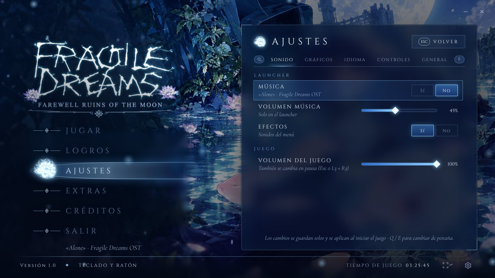 |
| 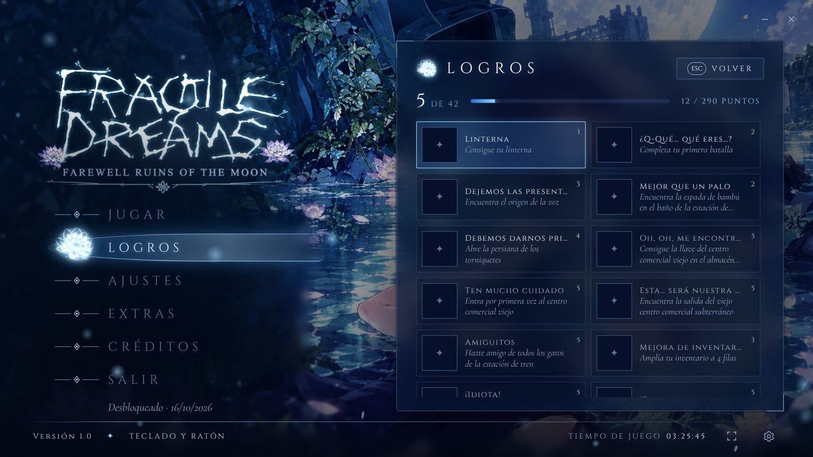 | 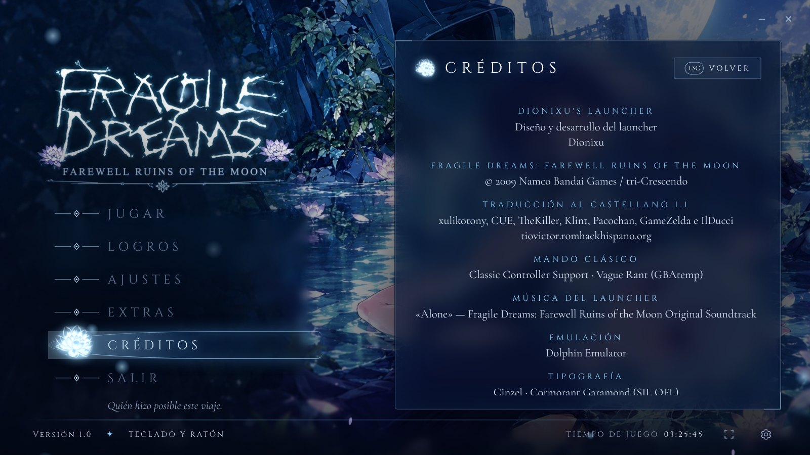 |

| En el juego | |
|---|---|
| 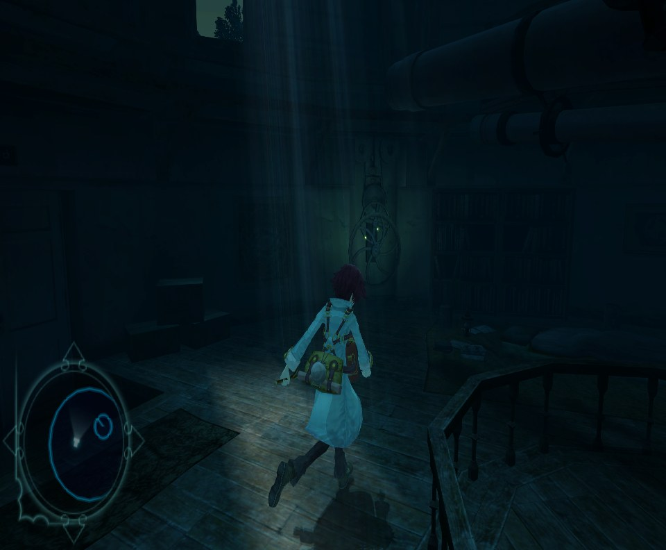 | 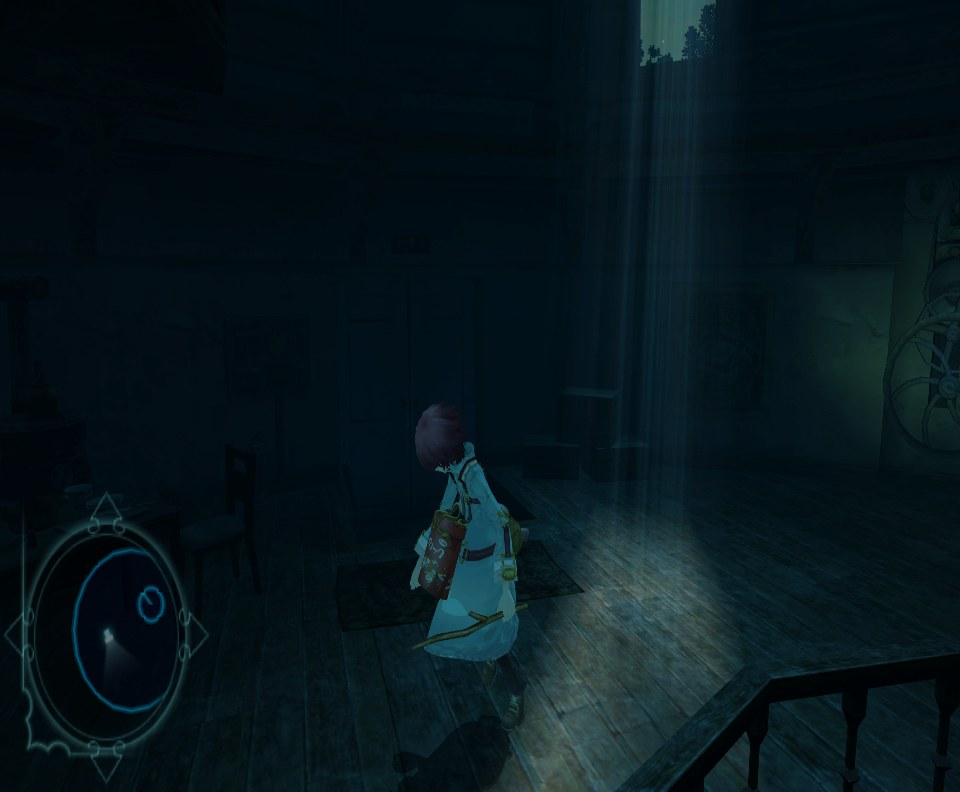 |

| Instalador | |
|---|---|
| 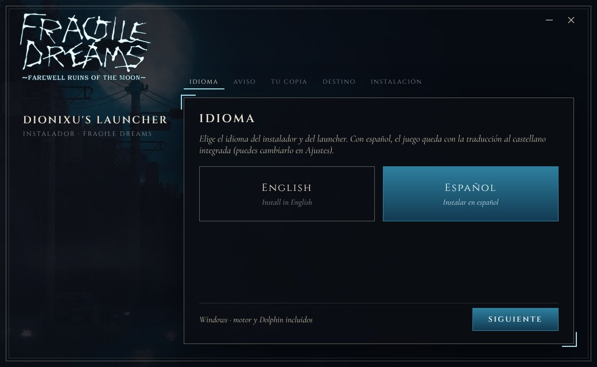 | 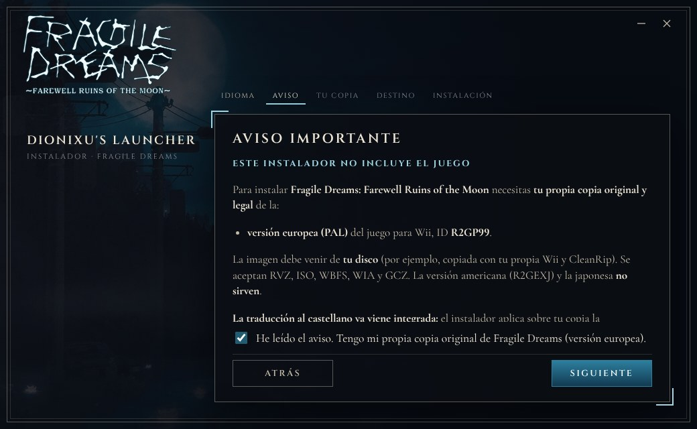 |
| 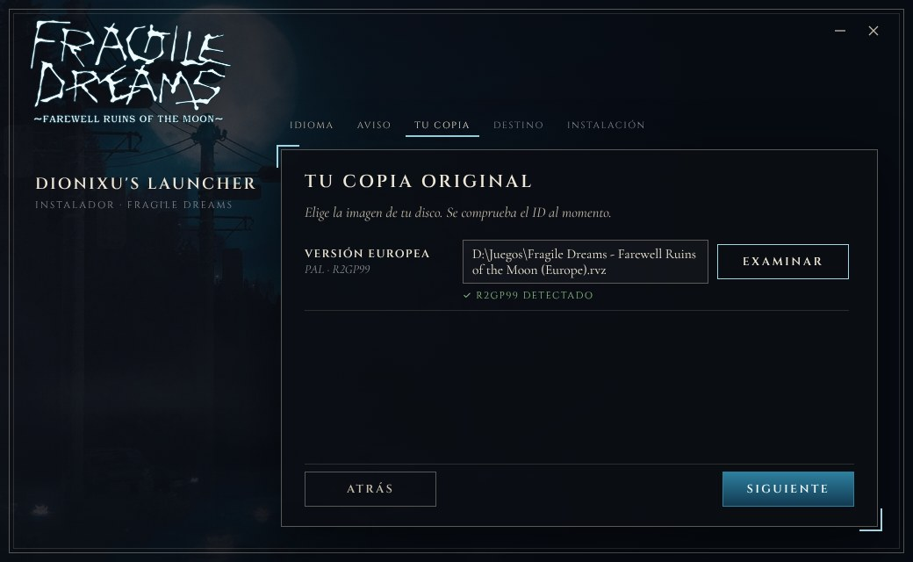 | 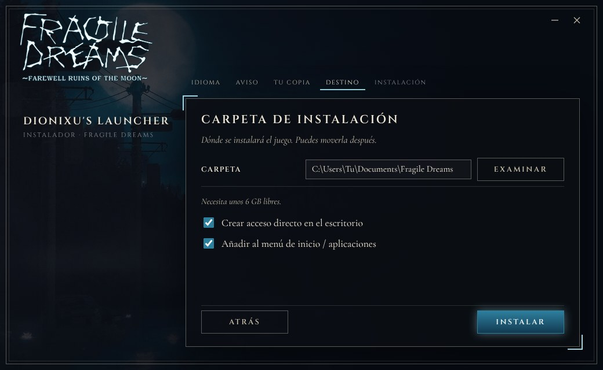 |
| 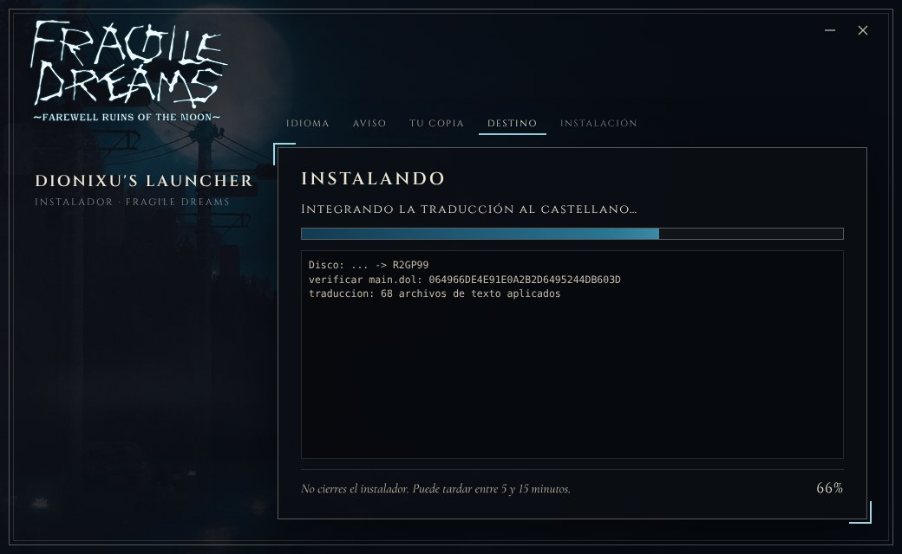 | |

## Descargas

Todo está en **[Releases](../../releases/latest)**:
- **Windows 10/11 (64 bits):** `Fragile_Dreams_Instalador_Windows_vX.Y.Z.zip` — el motor, el núcleo de Dolphin y Dolphin vienen incluidos.
- **Linux:** `Instalar_Fragile_Dreams-x86_64.AppImage` (Debian 12, Ubuntu 22.04, Mint 21, Fedora 36 o más nuevos). Usa tu propio Dolphin.

## Instalación

### Windows (10 u 11, 64 bits)
1. Ten unos **6 GB libres** y tu copia **europea** (`R2GP99`) en `.rvz`, `.iso`, `.wbfs`, `.wia` o `.gcz`.
2. Descarga el `.zip` de Windows y **descomprímelo entero** (no ejecutes el instalador desde dentro del `.zip`).
3. Abre **`Instalar Fragile Dreams.exe`**. Si SmartScreen avisa: *Más información → Ejecutar de todas formas*.
4. Elige el idioma, acepta el aviso legal y elige tu copia europea: se comprueba al momento.
5. Elige la carpeta (por defecto `Documentos\Fragile Dreams`) y pulsa **INSTALAR**. Tarda de 5 a 15 minutos y el launcher se abre solo.
6. Opcional: ejecuta **`AGREGAR_A_STEAM.bat`** (en la carpeta del juego) para añadirlo a Steam con portada, fondo y logo.

### Linux (AppImage)
1. Ten unos **6 GB libres** y tu copia europea.
2. Instala **tu propio Dolphin** (recomendado el Flatpak):
   ```bash
   sudo apt install flatpak
   flatpak remote-add --if-not-exists flathub https://dl.flathub.org/repo/flathub.flatpakrepo
   flatpak install flathub org.DolphinEmu.dolphin-emu
   ```
3. Da permiso de ejecución y abre el AppImage:
   ```bash
   chmod +x Instalar_Fragile_Dreams-x86_64.AppImage
   ./Instalar_Fragile_Dreams-x86_64.AppImage
   ```
   Si no abre, instala FUSE (`sudo apt install libfuse2`) o usa `--appimage-extract-and-run`.
4. Elige idioma, aviso, tu copia y tu Dolphin, y pulsa **INSTALAR** (por defecto `~/Games/Fragile Dreams`).

5. Opcional, **Steam / Steam Deck**: en la carpeta del juego ejecuta `./agregar_a_steam.sh` (el `.bat` es solo de Windows; este script hace lo mismo con Python 3: portada, fondo, logo e icono).

> En Linux el juego corre en tu Dolphin: la cámara con stick derecho/ratón y los 60 FPS son del motor de Windows y no están disponibles. El movimiento 360°, el mando, los iconos de botones, el menú de pausa y los logros sí.

### Problemas
- Envía `instalacion.log` (en la carpeta de instalación) o `launcher/data/launcher.log`.
- Si el mando no responde con Steam: en Steam, *clic derecho al juego → Propiedades → Mando → Desactivar Steam Input*.

## Compilación (para desarrolladores)

Los instaladores los arma **GitHub Actions** (`.github/workflows/build.yml`) al cambiar `VERSION` o crear una etiqueta `v*`:
- `herramientas/build_linux.sh` compila `fd_logros` (rcheevos) y `pt_bridge` para Linux.
- `motor/build_mingw.sh` compila el motor `fd_motor.exe` con MinGW-w64 (si falla se usa `motor/bin/fd_motor.exe`).
- El instalador de Windows es Electron + `instalador/app`; el AppImage se arma con `instalador/build/appimage.js` (sin herramientas de Linux).
- Parches del juego: `launcher/data/parche_juego_eur.json` (generado con `herramientas/gen_mod_juego.py`) y `parche_mando_eur.json`.
- Bitácora técnica completa: [`docs/BITACORA.md`](docs/BITACORA.md) y [`docs/PROYECTO_NOTAS.md`](docs/PROYECTO_NOTAS.md).

## Créditos

- **Dionixu** ([@kaiwolft](https://github.com/kaiwolft)) — autor del proyecto, diseño y pruebas.
- Desarrollado junto a **Claude** (Anthropic).
- **daetrox** ([@daetrox](https://github.com/daetrox)) — correcciones de Linux heredadas de los launchers anteriores.
- **Traducción al castellano 1.1:** xulikotony, CUE, TheKiller, Klint, Pacochan, GameZelda e IlDucci — TioVictor · Romhack Hispano.
- **Classic Controller Support:** Vague Rant (GBAtemp).
- **Logros:** set oficial de RetroAchievements (juego 131) y sus autores; evaluados con [rcheevos](https://github.com/RetroAchievements/rcheevos).
- **Emulación:** [Dolphin Emulator](https://dolphin-emu.org) (GPLv2) y su núcleo libretro. **Interfaz:** Electron. **Tipografías:** Cinzel y Cormorant Garamond (SIL OFL).
- **Música del launcher:** «Alone», de la banda sonora original de *Fragile Dreams*.
- *Fragile Dreams: Farewell Ruins of the Moon* © 2009 Namco Bandai Games / tri-Crescendo. Publicado en Europa por Rising Star Games y en América por XSEED Games. Arte y música pertenecen a sus titulares; se retirarán si lo solicitan.

## ☕ Apoyo

Si este proyecto te gustó, puedes invitarme un café en **[Ko-fi](https://ko-fi.com/dionixu838824)**. ¡Gracias!

---

<a id="english"></a>
## English

Launcher, engine and installers for Windows and Linux that turn **your original European copy** of *Fragile Dreams: Farewell Ruins of the Moon* (Wii) into a PC experience: **built-in Spanish translation**, right-stick and mouse camera, 360° movement, **60 FPS**, Xbox or keyboard & mouse button prompts, a pause menu and achievements.

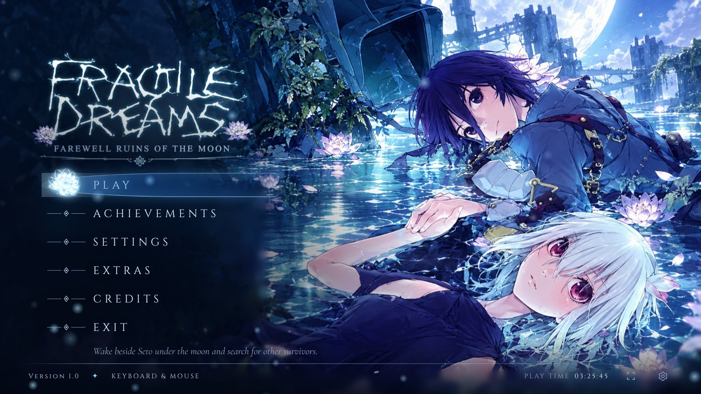

### ⚠️ Legal notice
- This project **does NOT include the game**.
- You need **your own original copy** of *Fragile Dreams* for Wii, dumped by you from your disc (e.g. with your Wii and CleanRip):
  - **European (PAL) version, ID `R2GP99`. It is the only one that works.** The US (`R2GEXJ`) and Japanese versions will not work.
- The installer checks your copy (ID and MD5 fingerprint) and **only works with your official, unmodified copy**.
- **Piracy is not accepted or encouraged.** Do not download or share game images.
- Non-profit fan project, not affiliated with Namco Bandai Games, tri-Crescendo, Rising Star Games or XSEED Games. Content will be removed if the rights holders ask.

### Built-in Spanish translation
The installer applies the **Spanish fan translation 1.1** (xulikotony, CUE, TheKiller, Klint, Pacochan, GameZelda and IlDucci — TioVictor · Romhack Hispano) to your European copy. No Riivolution needed. The original English, French and German text stays available in Settings, with English or Japanese voices.

### Features
- Game-themed launcher (moon, water and lotus flowers) in **Spanish and English**, with the OST track *"Alone"*.
- **Custom engine** (Windows) built on the Dolphin core: windowed / fullscreen / borderless, V-Sync, works with Discord/OBS capture.
- **Free camera** with the right stick in third and first person, and **PC-style mouse look**.
- **360° movement** (no more walking backwards) and **the flashlight follows Seto's facing**.
- Optional **60 FPS** (experimental) with fixed animations.
- Xbox controller and keyboard/mouse at the same time, automatic switching, rebindable keys; **Xbox or keyboard & mouse button prompts** in game (tutorials included).
- Pause menu with **L3 + R3** or **F1**: live game volume and back to the launcher.
- **42 offline RetroAchievements** with in-game pop-ups. **They are kept when you save your game.**
- No Wii Remote strap screen. Play time, custom cursor and `AGREGAR_A_STEAM.bat` (Windows) and `agregar_a_steam.sh` (Linux / Steam Deck) to add it to Steam with artwork.

### Screenshots
| | |
|---|---|
| 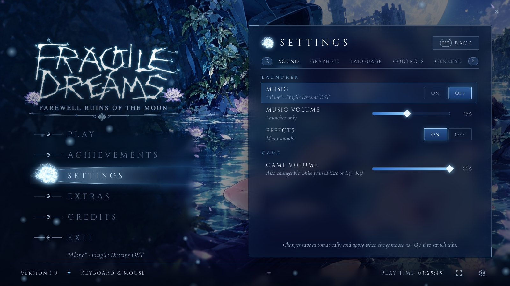 |  |
|  |  |

### Downloads
Everything is in **[Releases](../../releases/latest)**:
- **Windows 10/11 (64-bit):** `Fragile_Dreams_Instalador_Windows_vX.Y.Z.zip` — engine, Dolphin core and Dolphin included.
- **Linux:** `Instalar_Fragile_Dreams-x86_64.AppImage` (Debian 12, Ubuntu 22.04, Mint 21, Fedora 36 or newer). Uses your own Dolphin.

### Installation
**Windows:** have ~6 GB free and your **European** copy (`R2GP99`) as `.rvz/.iso/.wbfs/.wia/.gcz` → extract the whole `.zip` → open **`Instalar Fragile Dreams.exe`** (SmartScreen: *More info → Run anyway*) → pick the language, accept the notice, choose your copy → choose the folder (default `Documents\Fragile Dreams`) → **INSTALL** (5–15 min). Optional: run **`AGREGAR_A_STEAM.bat`** from the game folder.

**Linux:** install your own Dolphin (`flatpak install flathub org.DolphinEmu.dolphin-emu`), then
```bash
chmod +x Instalar_Fragile_Dreams-x86_64.AppImage
./Instalar_Fragile_Dreams-x86_64.AppImage
```
(if it does not start: `sudo apt install libfuse2` or `--appimage-extract-and-run`). On Linux the game runs in your Dolphin: the right-stick/mouse camera and 60 FPS belong to the Windows engine and are not available.

**Steam / Steam Deck (Linux):** in the game folder run `./agregar_a_steam.sh` (the `.bat` is Windows-only; this script does the same with Python 3: cover, background, logo and icon).

**Problems:** send `instalacion.log` (install folder) or `launcher/data/launcher.log`. If the controller does not respond under Steam: *right-click the game → Properties → Controller → Disable Steam Input*.

### Building
Installers are built by **GitHub Actions** (`.github/workflows/build.yml`) when `VERSION` changes or a `v*` tag is pushed. See the Spanish section above for the build scripts and [`docs/BITACORA.md`](docs/BITACORA.md) for the full technical log.

### Credits
**Dionixu** ([@kaiwolft](https://github.com/kaiwolft)) — author; developed together with **Claude** (Anthropic); **daetrox** ([@daetrox](https://github.com/daetrox)) — Linux fixes; Spanish translation 1.1 team (xulikotony, CUE, TheKiller, Klint, Pacochan, GameZelda, IlDucci — TioVictor · Romhack Hispano); **Vague Rant** — Classic Controller Support; RetroAchievements set authors and rcheevos; Dolphin Emulator (GPLv2) and its libretro core; Electron; Cinzel and Cormorant Garamond (SIL OFL); launcher music "Alone" from the *Fragile Dreams* OST. *Fragile Dreams: Farewell Ruins of the Moon* © 2009 Namco Bandai Games / tri-Crescendo (Rising Star Games / XSEED Games).

### ☕ Support
If you enjoyed this project, you can buy me a coffee on **[Ko-fi](https://ko-fi.com/dionixu838824)**. Thank you!
